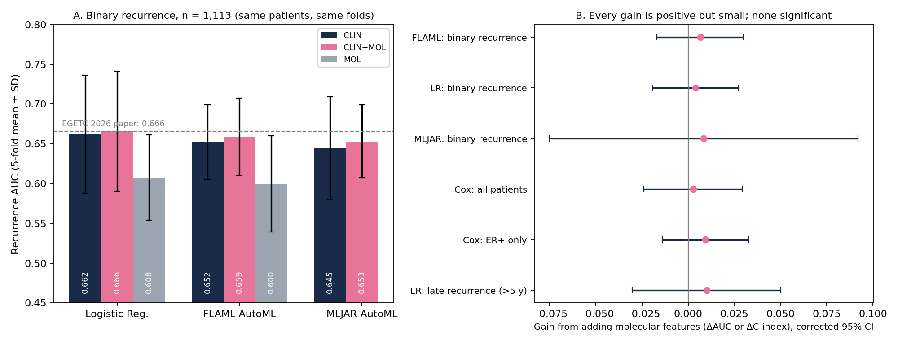

# Phase 1 Pilot Report: Can Molecular Labels Break the Recurrence Ceiling?

Tri Nham · Phase 1 pilot · October 2026
Follow-up to *Multi-Target Machine Learning for Breast Cancer Prognosis and Molecular Classification Using METABRIC* (EGETC 2026, Best Paper Award)



## 1. Bottom line

In the EGETC 2026 paper, recurrence was the hardest target: the nested Traditional ML pipeline reached a mean AUC of 0.666 with clinical and treatment features only. Phase 1 asked whether adding the molecular, genomics-derived variables that METABRIC already ships in its clinical table (PAM50 subtype, Integrative Cluster, 3-gene classifier, HER2 copy-number state from SNP6, and tumour cellularity) moves that number.

The answer is "a little, and in the direction biology predicts, but not yet convincingly." Across three model families (logistic regression, FLAML AutoML, MLJAR AutoML), adding molecular features improved recurrence AUC by +0.004 to +0.008. When the endpoint was reframed in more biologically sensible ways, the gain grew slightly: +0.003 C-index for time-to-recurrence in all patients, +0.009 in ER-positive patients only, and +0.010 AUC for late recurrence after five years. Every one of the six comparisons pointed in the positive direction, but none was statistically significant after correction, and all confidence intervals cross zero.

This is a useful result, not a disappointing one. It tells us that the coarse molecular *labels* mostly repeat information the clinical model already has, and it points to exactly where the next phase should go: gene-level data (expression, copy number, mutations), a time-to-event endpoint, and a focus on late recurrence in ER-positive disease.

## 2. Why genomics should help predict recurrence

### 2.1 What a recurrence actually is

A recurrence is not a new event that happens years after surgery. It is the regrowth of cancer cells that had already left the primary tumour before or around the time of treatment and survived it as micrometastatic disease. Whether those cells eventually regrow depends on three things: how many cells escaped, how aggressively they can proliferate, and whether they can stay dormant, evade the immune system, and resist therapy for years.

The clinical features in our model measure the first of these reasonably well. Tumour size and the number of positive lymph nodes are direct proxies for how much disease had a chance to spread, which is why nodal status and the NPI dominated both the marginal effect sizes and the SHAP rankings in the EGETC paper. What clinical features capture poorly is the second and third piece: the intrinsic behaviour of the tumour cells. Histologic grade is a pathologist's visual summary of proliferation and differentiation, and receptor status (ER, PR, HER2 by immunohistochemistry) is a three-marker summary of signalling state. Both are coarse, partly subjective, and grade in particular leaves a large ambiguous middle (grade 2) where tumours with very different biology are lumped together. Genomic measurements describe the same biology at much higher resolution, which is the core reason to expect them to help.

### 2.2 Proliferation: the strongest genomic signal

Most commercial breast cancer recurrence tests are, at their core, refined measurements of proliferation combined with hormone-receptor signalling. The 21-gene Recurrence Score was developed to predict distant recurrence in tamoxifen-treated, node-negative patients (Paik et al., 2004), and the PAM50 risk-of-recurrence score combines intrinsic subtype with a proliferation component. When Dowsett et al. (2013) compared PAM50 ROR, the 21-gene score, and IHC4 in about 1,000 ER-positive patients from the ATAC trial, the PAM50 ROR score added prognostic information about 10-year distant recurrence beyond standard clinicopathological variables. In other words, there is direct evidence that expression-based measurement of tumour biology carries information that size, nodes, and grade do not.

### 2.3 ER-positive disease recurs late, and clinical stage alone does not say who

ER-positive breast cancer behaves differently from other subtypes. A meta-analysis of 88 trials and nearly 63,000 women who were disease-free after five years of endocrine therapy found that recurrences continued at a steady rate from year 5 to year 20, with 20-year distant recurrence risks ranging from roughly 10% to 41% depending on tumour size, nodes, and grade (Pan et al., 2017). Clinical stage tells us how much risk there is on average, but it does not separate the patients who will relapse at year 12 from those who never will. Sestak et al. (2018) compared six prognostic signatures in ATAC and found that in node-negative patients, the PAM50 ROR, Breast Cancer Index, and EPclin were significantly more prognostic than the clinical treatment score for overall and late distant recurrence. Late recurrence in ER-positive disease is therefore the place where genomics has the strongest documented edge over clinical variables.

### 2.4 Copy-number drivers and the Integrative Clusters

METABRIC itself is the reason the Integrative Clusters exist. Curtis et al. (2012) combined copy-number and expression data from about 2,000 METABRIC tumours and found ten integrative subgroups, several defined by specific amplified regions (for example, IntClust 2 by 11q13/14 amplification and IntClust 5 by ERBB2 amplification). Rueda et al. (2019) then modelled the full course of relapse in 3,240 patients, including 1,980 with molecular data, and showed that integrative subtypes improve the prediction of late distant relapse beyond nodal status, tumour size, grade, and immunohistochemical subtype. They identified four ER-positive integrative subgroups (reported in the paper as IntClust 1, 2, 6, and 9) with high late-relapse risk and enrichment for copy-number amplifications. This is the most direct published evidence that genomic features should help on our exact dataset and exact endpoint.

### 2.5 Mutations and the tumour microenvironment

Pereira et al. (2016) sequenced 173 genes in 2,433 METABRIC tumours and found that mutations in genes such as TP53 and PIK3CA are associated with outcome in a subtype-dependent way. Beyond the tumour cells themselves, immune infiltration and stromal composition influence whether disseminated cells are kept in check. Our current feature set contains only a total mutation count, which throws away which genes are mutated, and contains nothing about the immune environment.

### 2.6 A realistic expectation

The literature supports *incremental* rather than transformative gains. Signatures add significant information on top of clinical variables, but the published improvements are measured in modest changes to likelihood-ratio statistics and hazard ratios, not jumps from 0.66 to 0.85 AUC. A reasonable target for a well-designed genomic extension is a gain of roughly 0.02 to 0.05 in AUC or C-index, concentrated in ER-positive late recurrence. Being upfront about that in the paper will make the work more credible.

## 3. What Phase 1 tested

### 3.1 Data and cohort

The analysis uses the same 2,509-patient, 34-column METABRIC clinical table as the EGETC paper. The target is the recorded relapse-free status (recurred versus not recurred); unknown outcomes are excluded rather than treated as negative. All feature sets were evaluated on the **same 1,113 patients** who had a recorded outcome and complete data for both clinical and molecular variables (463 recurred, 41.6%). The cohort is smaller than the paper's 1,296 mainly because tumour cellularity is missing more often than other fields; this is noted as a limitation below.

### 3.2 Feature sets

| Set | Contents | Count |
|---|---|---|
| CLIN | The 22 clinical, receptor, and treatment features from the EGETC paper | 22 |
| CLIN+MOL | CLIN plus PAM50 + claudin-low subtype, Integrative Cluster (11 groups), 3-gene classifier, HER2 copy-number state (SNP6), cellularity | 47 |
| MOL | Molecular features plus age only, to see how far biology alone goes | 26 |

### 3.3 Methods

Three model families were compared on identical, seeded, stratified five-fold outer splits (seed 42), mirroring the paper: logistic regression (fixed, C = 1, scaled inside each fold); FLAML AutoML (45 seconds per fold, searching LightGBM, XGBoost, random forest, extra trees, and L1 logistic regression with internal three-fold CV on the training fold only); and MLJAR AutoML in Explain mode (the same mode used in the paper, eval metric AUC). AutoML tuning never sees the outer test fold. The change in AUC between CLIN+MOL and CLIN was tested with the Nadeau–Bengio corrected paired t-test (four degrees of freedom), with Holm adjustment across methods, as in the paper.

Because the binary label ignores *when* a recurrence happened, a second script tested three reframings using logistic regression and penalised Cox models: (A) time-to-recurrence in all patients, scored by the five-fold cross-validated Harrell C-index; (B) the same, restricted to ER-positive patients; and (C) late recurrence, defined among patients still recurrence-free and followed beyond 60 months.

Feature-group importance was measured by permuting whole groups of related columns together on the held-out fold (for example, all eleven IntClust indicators at once) and recording the AUC drop.

## 4. Results

### 4.1 Binary recurrence (n = 1,113)

| Method | CLIN | CLIN+MOL | MOL only | Gain (CLIN+MOL − CLIN) | Corrected 95% CI | Holm p | Folds improved |
|---|---|---|---|---|---|---|---|
| Logistic regression | 0.662 ± 0.074 | 0.666 ± 0.076 | 0.608 ± 0.054 | +0.004 | −0.019 to +0.027 | 1.00 | 3 / 5 |
| FLAML AutoML | 0.652 ± 0.047 | 0.659 ± 0.049 | 0.600 ± 0.061 | +0.006 | −0.017 to +0.030 | 1.00 | 4 / 5 |
| MLJAR AutoML | 0.645 ± 0.065 | 0.653 ± 0.046 | not run | +0.008 | −0.075 to +0.092 | 1.00 | 4 / 5 |

Values are mean AUC ± fold standard deviation. The clinical baseline reproduces the paper closely (0.662 here versus 0.655 for fixed logistic regression in the paper), which gives confidence that the pipeline is consistent. Molecular features alone reach about 0.60–0.61, meaningfully above chance but well below the clinical model. FLAML's pooled out-of-fold AUC fell slightly with molecular features (0.649 to 0.640) even though its fold-mean rose, which is another sign that the effect is within noise.

### 4.2 Reframed endpoints

| Analysis | n (events) | CLIN | CLIN+MOL | Gain | Corrected 95% CI |
|---|---|---|---|---|---|
| A. Cox, time-to-recurrence, all patients | 1,112 (462) | C = 0.656 | C = 0.659 | +0.003 | −0.024 to +0.029 |
| B. Cox, time-to-recurrence, ER+ only | 863 (350) | C = 0.650 | C = 0.659 | +0.009 | −0.014 to +0.033 |
| C. Late recurrence after 5 years (LR) | 745 (175) | AUC = 0.586 | AUC = 0.596 | +0.010 | −0.030 to +0.050 |

The ordering is the interesting part. The gain is smallest when every patient and every recurrence is pooled together, and largest in ER-positive patients and in late recurrence, which is exactly the pattern Rueda et al. (2019) would predict. With these sample sizes the differences are not significant, so this is a hypothesis for Phase 2, not a finding.

### 4.3 Late recurrence by Integrative Cluster (ER+, recurrence-free at 5 years, n = 603)

Overall, 25.9% of these ER-positive patients recurred after year five. The rate differed by cluster:

| IntClust | Patients at risk | Recurred after 5 years |
|---|---|---|
| 2 | 27 | 44.4% |
| 5 | 20 | 40.0% |
| 9 | 45 | 31.1% |
| 4ER+ | 96 | 30.2% |
| 1 | 46 | 26.1% |
| 6 | 32 | 25.0% |
| 8 | 108 | 24.1% |
| 3 | 132 | 21.2% |
| 7 | 81 | 19.8% |

IntClust 2 and 9, two of the high-risk groups described by Rueda et al., sit near the top, while IntClust 3 and 7, generally considered good-prognosis ER-positive groups, sit at the bottom. The groups are small (20–132 patients) and this is descriptive only, but it is reassuring that the raw data line up with the published biology.

### 4.4 Which features did the work

For the FLAML models on CLIN+MOL, permuting lymph-node features dropped AUC by 0.051 and permuting the NPI/grade/size/stage block dropped it by 0.048. Every molecular group, including IntClust (0.002), PAM50 (0.000), and the 3-gene classifier (0.002), caused a drop of 0.002 or less. Logistic regression told a different story on the surface, with IntClust showing a large permutation importance (0.075), but this reflects substitution rather than new information: the linear model shifted weight from grade and receptor columns onto the correlated IntClust indicators while its overall AUC barely changed. Both views lead to the same conclusion. The categorical molecular labels are largely redundant with ER status, HER2 status, and grade, which are already in the clinical model.

## 5. Why the gain was small

Four reasons, roughly in order of importance. First, **redundancy**: PAM50, the 3-gene classifier, and most IntClust groups are themselves strongly organised around ER, HER2, and proliferation, which the model already sees through receptor status and grade. Second, **coarse encoding**: a subtype label compresses thousands of genes into one category. The published signatures that beat clinical variables use continuous scores, especially continuous proliferation, not category labels. Third, **the endpoint**: a yes/no label without follow-up time mixes early recurrences (driven largely by ER-negative, highly proliferative tumours) with late ones (driven by ER-positive biology), and treats a patient followed for two years the same as one followed for twenty. The reframed analyses suggest the signal sharpens when this is fixed. Fourth, **power**: with five folds and fold-to-fold AUC standard deviations of 0.05–0.07, this design cannot reliably detect gains smaller than about 0.03. Repeated cross-validation and a larger cohort are needed.

## 6. Options considered for Phase 2 (at the end of Phase 1)

These are the options identified at the end of Phase 1, ordered by expected payoff for effort. Phase 2 implemented Options 1 to 4 and 6; see Phase2_Methods_and_Findings.md for the results.

**Option 1: Bring in gene-level data.** This is the essential next step. The cBioPortal METABRIC study (`brca_metabric`) provides mRNA expression z-scores, gene-level copy-number calls, and mutation calls for the 173-gene panel. These are downloaded from cBioPortal into `data/brca_metabric/`; they are not part of the 34-column clinical table used in Phase 1.

**Option 2: Knowledge-driven signatures, not raw genes.** With roughly 1,100–1,900 patients and more than 20,000 genes, feeding every gene into AutoML invites overfitting. A stronger and more publishable design is to build a small number of biologically defined scores from the expression data: a continuous proliferation score (for example, from genes such as MKI67, AURKA, BIRC5, CCNB1, and MYBL2), an ER-signalling score, research-grade approximations of published signatures (PAM50 ROR-style, 21-gene-style), and immune and stromal scores. Each score has a clear clinical meaning, which also makes the SHAP explanations easier to defend.

**Option 3: Driver copy-number and mutation features.** Use specific amplifications linked to late relapse (for example CCND1 at 11q13, FGFR1 at 8p12, MYC at 8q24, ERBB2) and specific mutations (TP53, PIK3CA, GATA3, MAP3K1, CDH1) instead of a total mutation count.

**Option 4: Change the endpoint to time-to-event.** Use penalised Cox models, random survival forests, and a deep survival model, scored with the C-index and time-dependent AUC at 5 and 10 years. This also addresses one of the main limitations reviewers raised about the EGETC paper (binary status endpoints without censoring).

**Option 5: Make ER-positive late recurrence the headline question.** This is where biology and prior literature say genomics should help most, and Phase 1 already hints at it. A clear title for the next paper would be along the lines of *"When do genomic features add to clinical prediction of breast cancer recurrence? A late-relapse analysis in METABRIC."*

**Option 6: Stronger validation.** Use repeated nested cross-validation (for example 5 × 5) to tighten the confidence intervals, and, if possible, an external cohort with expression data and recurrence follow-up to test transportability.

## 7. Limitations

The cohort is restricted to 1,113 complete-case patients, mostly because of missing cellularity, and complete-case filtering in METABRIC is not random. The molecular variables are pre-computed categorical labels rather than raw measurements. All results are internal cross-validation within one historical cohort (diagnosed 1977–2005, before routine trastuzumab use). Treatment variables reflect clinical decisions and should not be read as causal effects. MLJAR was run in Explain mode with default models, as in the paper; a longer tuning budget could change the absolute numbers but is unlikely to change the comparison, because the same budget applies to both feature sets.

## 8. Reproducing Phase 1

From the project folder (see the README for setup):

```bash
cd src
python run_recurrence_molecular.py    # binary recurrence: LR, FLAML, MLJAR on CLIN / CLIN+MOL / MOL
python run_survival_framing.py        # time-to-event, ER+ and late-recurrence reframings
```

Outputs are written to `results/pilot/`: `summary.csv`, `paired_tests.csv`, `fold_auc.csv`, `oof_predictions.csv`, `group_importance.csv`, `survival_framing_summary.csv`, `survival_framing_tests.csv`, `late_recurrence_by_intclust_ERpos.csv`, and `fig_recurrence_molecular.png`.

## References

Curtis C, Shah SP, Chin SF, et al. The genomic and transcriptomic architecture of 2,000 breast tumours reveals novel subgroups. *Nature* 2012;486:346–352.

Dowsett M, Sestak I, Lopez-Knowles E, et al. Comparison of PAM50 risk of recurrence score with Oncotype DX and IHC4 for predicting risk of distant recurrence after endocrine therapy. *J Clin Oncol* 2013;31:2783–2790.

Nadeau C, Bengio Y. Inference for the generalization error. *Machine Learning* 2003;52:239–281.

Paik S, Shak S, Tang G, et al. A multigene assay to predict recurrence of tamoxifen-treated, node-negative breast cancer. *N Engl J Med* 2004;351:2817–2826.

Pan H, Gray R, Braybrooke J, et al. 20-year risks of breast-cancer recurrence after stopping endocrine therapy at 5 years. *N Engl J Med* 2017;377:1836–1846.

Pereira B, Chin SF, Rueda OM, et al. The somatic mutation profiles of 2,433 breast cancers refine their genomic and transcriptomic landscapes. *Nat Commun* 2016;7:11479.

Rueda OM, Sammut SJ, Seoane JA, et al. Dynamics of breast-cancer relapse reveal late-recurring ER-positive genomic subgroups. *Nature* 2019;567:399–404.

Sestak I, Buus R, Cuzick J, et al. Comparison of the performance of 6 prognostic signatures for estrogen receptor–positive breast cancer: a secondary analysis of a randomized clinical trial. *JAMA Oncol* 2018;4:545–553.
