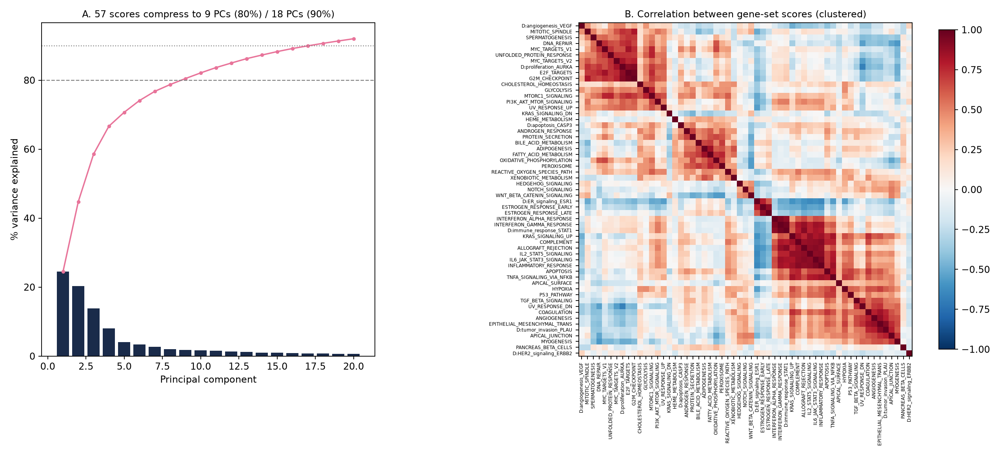

# METABRIC Recurrence: Clinical and Multi-Omic Prediction — Methods and Findings

Tri Nham · Phase 2 · October 2026
Follow-up to *Multi-Target Machine Learning for Breast Cancer Prognosis and Molecular Classification Using METABRIC* (EGETC 2026)

## 1. Summary

Recurrence was the weakest target in the EGETC 2026 paper (AUC 0.666 with clinical and treatment features). This project asks whether molecular data improve recurrence prediction, and for which patients. We built a patient-level dataset that joins the METABRIC clinical table with gene-expression gene-set scores, copy-number and mutation driver features, DNA methylation features, and immune and stromal cell estimates, and evaluated it with fold-safe cross-validation across Cox regression, random survival forests, logistic regression, LightGBM, FLAML, and MLJAR.

Internally the answer is consistent across methods. Genomic features improve recurrence prediction in **ER-positive patients** by about 0.02 to 0.03 in C-index or AUC. With tuned models and 50 cross-validation splits, a random survival forest using clinical features plus a reduced genomic set reached a C-index of 0.661 versus 0.633 for clinical features alone (+0.028, improved in 45 of 50 splits, Holm-adjusted p = 0.016). Gains for all patients combined were small and not significant, genomic features did not help predict recurrence after five years, and methylation and immune cell features added nothing beyond the genomic features.

In **external validation on TCGA-BRCA** (train on METABRIC, test on TCGA), the ER+ gain kept its direction for penalised Cox (+0.014 C-index) but was smaller and not statistically significant (66 ER+ events, median follow-up 25 months), and the random survival forest did not transfer. The ER+ genomic signal is therefore supported internally and directionally externally, with the linear Cox model the more robust choice.

## 2. Background and rationale

A recurrence is the regrowth of tumour cells that had already disseminated before or around the time of treatment. Clinical features such as tumour size, nodal status, and the Nottingham Prognostic Index measure how much disease had the opportunity to spread; they describe the intrinsic behaviour of the tumour cells only coarsely, through grade and three receptor markers. Gene-expression assays measure that behaviour more directly, and several (the 21-gene Recurrence Score, PAM50 risk of recurrence, EndoPredict, Breast Cancer Index) add prognostic information to clinicopathological variables, particularly in ER-positive disease (Paik 2004; Dowsett 2013; Sestak 2018). Expression modules associated with outcome also differ by subtype: proliferation dominates in ER+/HER2− tumours, immune response in ER−/HER2− tumours (Desmedt 2008). METABRIC is the cohort in which the Integrative Clusters were defined (Curtis 2012) and in which copy-number-driven ER+ subgroups with high late-relapse risk were described (Rueda 2019).

Two expectations followed from this literature and guided the design: gains from genomic data should be **modest** (on the order of 0.02 to 0.05 in discrimination), and they should be **concentrated in ER-positive disease**.

Phase 1 (see `Phase1_Pilot_Report.md`) tested the categorical molecular labels already present in the clinical table (PAM50, IntClust, 3-gene classifier, HER2 copy-number state, cellularity). They added only +0.004 to +0.008 AUC, with slightly larger gains in ER+ patients and in late recurrence. The labels largely duplicated ER, HER2, and grade information, which motivated moving to gene-level data in Phase 2.

## 3. Data

| Source | Content | Patients |
|---|---|---|
| `Breast_Cancer_METABRIC.csv` | Clinical table used in the EGETC paper (34 columns) | 2,509 |
| cBioPortal `brca_metabric`: mRNA z-scores (Illumina HT-12) | 20,603 genes | 1,980 |
| cBioPortal: copy number (GISTIC, −2 to +2) | 22,544 genes | 1,985 |
| cBioPortal: mutations (173-gene targeted panel) | 17,272 mutations | 2,433 sequenced |
| cBioPortal: promoter methylation (RRBS, beta 0–1) | 13,188 promoters | 1,418 |

All files share the METABRIC patient identifier (MB-xxxx); each patient has one tumour sample and the sample ID equals the patient ID (verified for all 2,509). The final dataset, `data/processed/metabric_recurrence_multiomics.csv`, has one row per patient and 141 columns; `feature_dictionary.csv` documents every engineered column.

**Outcome.** Relapse-free status (recurred vs not recurred) and relapse-free months. Unknown outcomes were left missing, never treated as negative.

**Modelling cohort.** Patients with a recorded outcome and complete clinical and genomic data: **1,295 patients, 545 recurrences** (996 ER+, 408 recurrences). Methylation analyses use the 945 of these with methylation data.

## 4. Feature engineering: what and why

All molecular features are computed **per patient from that patient's own measurements and fixed, published gene lists**. No outcome information and no information from other patients is used, so the features themselves cannot leak test-set information into training.

### 4.1 Clinical baseline (22 features)

The same 22 clinical, receptor, and treatment features as the EGETC paper (age, grade, positive nodes, mutation count, NPI, tumour size and stage, ER/PR/HER2 status, chemotherapy, hormone therapy, radiotherapy, mastectomy, menopausal status, and derived indicators), so every comparison is against the published baseline.

### 4.2 Gene-expression gene-set scores (57 features)

*Why gene sets rather than individual genes.* With about 1,300 patients and 20,000 genes, using genes directly invites overfitting and produces results that are hard to interpret. Gene sets group genes that act together in a biological process, compress the data, and make model explanations meaningful ("the proliferation score drove this prediction").

- **MSigDB Hallmark (50 sets; Liberzon 2015).** Curated, non-redundant sets each representing one biological process (cell cycle, estrogen response, hypoxia, inflammation, metabolism, and others). Score = mean z-score of the member genes present in METABRIC (95–100% coverage, median 99%). Hallmarks were **not hand-picked**: all 50 were included and the data decided which mattered.
- **Desmedt breast-cancer modules (7; Desmedt 2008).** Built from breast tumours around prototype genes: AURKA (proliferation), ESR1 (ER signalling), ERBB2 (HER2 signalling), STAT1 (immune response), PLAU (invasion), VEGF (angiogenesis), and CASP3 (apoptosis). Score = weighted average of member-gene z-scores using the published coefficients, Σ(w·z)/Σ|w|. Genes were matched by Entrez ID (905 of 913 found).

Duplicate probes for the same gene were averaged.

### 4.3 Copy-number driver features (11)

High-level amplification (+2) of nine recurrently amplified breast-cancer drivers, several of which define Integrative Clusters linked to late relapse: CCND1 (16.5% of tumours), PAK1 (9.1%), FGFR1 (12.9%), ZNF703 (14.0%), MYC (25.2%), RPS6KB1 (10.3%), PPM1D (9.9%), ERBB2 (15.1%), MDM2 (3.2%). Deep deletions of CDKN2A, PTEN, RB1, and MAP2K4 are each rare (0.7–2.4%), so they were combined into one indicator. **Fraction of genome altered** (share of genes with any copy-number change) was added as a measure of genomic instability.

### 4.4 Mutation driver features (9)

Indicator of any protein-changing (non-silent) mutation in eight frequently mutated drivers: PIK3CA (41.2%), TP53 (36.5%), KMT2C (11.8%), GATA3 (11.4%), MAP3K1 (10.0%), CDH1 (10.0%), AKT1 (4.2%), PTEN (4.0%), plus log mutation burden. Silent mutations were excluded because they do not change the protein. Sequenced patients without a mutation in a gene were coded 0.

### 4.5 DNA methylation features (20)

Motivated by Batra et al. (2021), who reported that epigenomic instability in METABRIC tumours correlates with grade, stage, TP53 mutation, and poorer prognosis. Features: global mean promoter methylation, within-tumour spread, fraction of strongly methylated promoters (beta > 0.5), fraction of intermediate values (0.2–0.8) as an epigenomic-disorder proxy, mean promoter methylation of each Desmedt module's genes, and promoter methylation of ten breast-cancer genes. The cBioPortal file contains no normal-tissue samples, so instability was measured within each tumour rather than against normal breast. Single-gene promoters missing in more than 1% of profiled tumours (for example BRCA1, ESR1) were excluded from modelling to avoid losing patients.

### 4.6 Immune and stromal cell estimates (10)

Motivated by evidence that immune composition is prognostic, with regulatory T cells and M0/M2 macrophages linked to poor outcome and CD8+ T cells to better outcome in ER− disease (Ali 2016), and that tumour-infiltrating lymphocytes are strongly prognostic in triple-negative disease (Loi 2019). MCP-counter marker genes (Becht 2016) were used to score ten populations: T cells, CD8 T cells, cytotoxic lymphocytes, NK cells, B lineage, monocytic lineage, myeloid dendritic cells, neutrophils, endothelial cells, and fibroblasts.

### 4.7 Biological sanity checks

The engineered features behave as expected: the Desmedt proliferation score rises with grade (−0.46, −0.20, +0.27 for grades 1–3) and correlates 0.90 with the Hallmark E2F-targets score; the ER-signalling score is higher in ER+ tumours (+0.21 vs −0.68); 95.1% of HER2-positive tumours carry ERBB2 amplification versus 3.6% of HER2-negative tumours; CCND1 amplification is found in 79% of IntClust 2 tumours; TP53 mutation is most frequent in basal tumours (88%); PGR promoter methylation is higher in PR-negative tumours; BRCA1 promoter methylation is highest in basal tumours; and CD8 T-cell scores are highest in claudin-low and basal tumours.

## 5. Redundancy among gene-set scores (PCA)

*Why.* Many Hallmark sets overlap, and correlated features can split importance between them, inflate model complexity, and mislead interpretation. PCA was used to measure this redundancy. PCA does not use the outcome, so it describes structure, not predictive value.

Across 1,980 tumours, the 57 scores compress to **9 principal components for 80% of the variance** (18 for 90%). PC1 (24.5%) is an immune and inflammation axis, PC2 (20.3%) a proliferation axis, and PC3 (13.8%) a metabolic and adipose axis. Hierarchical clustering (|r| ≥ about 0.7) grouped the 57 scores into 32 clusters; the largest were inflammation and immune signalling (8 sets), proliferation (7 sets, including Desmedt AURKA, E2F targets, G2M checkpoint, and MYC targets), invasion and EMT (4 sets, including Desmedt PLAU), and ER signalling (3 sets, including Desmedt ESR1 and both estrogen-response Hallmarks). See `results/phase2/fig_pca_redundancy.png`.

In modelling, PCA was refitted inside each training fold whenever principal components were used as features.

## 6. Modelling and validation: what and why

**Endpoints.** (1) Time to recurrence, which uses follow-up time and handles censoring correctly, scored by Harrell's C-index; (2) binary recurrence, scored by ROC AUC, for comparability with the EGETC paper and because AutoML tools support only classification. Pre-specified subgroups: ER+ patients (main question, from the literature above) and late recurrence (landmark analysis among patients recurrence-free and followed at 60 months, time measured from month 60).

**Feature sets.** CLIN (22); CLIN+DM (+7 Desmedt); CLIN+HM (+50 Hallmark); CLIN+PC (+9 principal components); CLIN+DRIVERS (+20 copy-number and mutation features); CLIN+GEN or CLIN+ALL (+all 77 genomic features); CLIN+PC+DRV (reduced: 9 PCs + 20 drivers, 51 features); CLIN+METH; CLIN+IMM; and combinations. Every comparison within an analysis uses the same patients and the same splits.

**Models.**
- Penalised (ridge) Cox regression, scikit-survival. In the tuned analysis the penalty was chosen from {1, 10, 100, 1000} by inner 3-fold CV on the training fold.
- Random survival forest (150 trees, √p features per split), with minimum leaf size chosen from {15, 40} by out-of-bag C-index on the training fold.
- L2 logistic regression and LightGBM with fixed settings, for binary recurrence and for SHAP.
- FLAML (40 s per fold, internal 3-fold CV; LightGBM, XGBoost, random forest, extra trees, L1 logistic regression) and MLJAR (Explain mode, as in the EGETC paper), both tuning only on the training fold.

**Validation.** Stratified 5-fold CV repeated 5 times (25 splits), or 10 times (50 splits) for the tuned survival models; single 5-fold CV for AutoML because of run time. Everything learned from data (scaling, PCA, penalty and leaf-size tuning, SHAP-based feature selection, AutoML search) happens inside the training fold. Differences from the clinical baseline were tested with the corrected repeated k-fold t-test (Bouckaert & Frank 2004) or the Nadeau–Bengio corrected t-test for single 5-fold CV, with Holm adjustment across the comparisons in each analysis.

*Why this design.* Correlated test folds make the ordinary paired t-test anticonservative; the corrected tests account for the overlap between training sets. Repeating cross-validation reduces the variance of the estimate, which matters when the expected gain (about 0.02–0.03) is similar in size to the fold-to-fold standard deviation.

**Interpretability.** TreeSHAP on LightGBM (CLIN+ALL) in each of the 25 test folds; we report mean |SHAP| and how often each feature ranks in the top 15. As an honest test of SHAP-based selection, the top 10 genomic features were also selected by SHAP inside each training fold and evaluated on the held-out fold (CLIN+SHAPSEL).

## 7. Results

### 7.1 All patients: feature-set comparison (n = 1,295, 25 splits)

| Feature set | Features | LR AUC | LightGBM AUC | Cox C-index |
|---|---|---|---|---|
| CLIN | 22 | 0.660 | 0.637 | 0.649 |
| CLIN+DM | 29 | 0.654 | 0.630 | 0.652 |
| CLIN+HM | 72 | 0.663 | 0.629 | 0.660 |
| CLIN+PC | 31 | 0.657 | 0.626 | 0.654 |
| CLIN+DRIVERS | 42 | 0.658 | 0.643 | 0.652 |
| CLIN+ALL | 99 | 0.655 | 0.636 | 0.653 |
| CLIN+SHAPSEL | 32 | 0.655 | 0.639 | 0.653 |

No feature set significantly improved on the clinical baseline for all patients combined (all Holm-adjusted p = 1.00; largest gain +0.011 C-index for CLIN+HM, improved in 18 of 25 splits). SHAP-selected features did not outperform using all features.

### 7.2 ER-positive patients and late recurrence (penalised Cox, fixed penalty, 25 splits)

| Analysis | n (events) | CLIN | +DM | +HM | +DRIVERS | +ALL |
|---|---|---|---|---|---|---|
| All patients | 1,295 (545) | 0.649 | 0.652 | 0.660 | 0.652 | 0.653 |
| **ER+ only** | 996 (408) | **0.627** | 0.640 | **0.661** | 0.635 | 0.659 |
| Late (>5 y), all | 873 (211) | 0.621 | 0.613 | 0.601 | 0.614 | 0.593 |
| Late (>5 y), ER+ | 703 (188) | 0.596 | 0.587 | 0.573 | 0.590 | 0.571 |

In ER+ patients, Hallmark scores added +0.034 (improved in 24 of 25 splits, raw p = 0.018, Holm p = 0.072) and all genomic features +0.032 (23 of 25 splits, Holm p = 0.14). For late recurrence, adding genomic features lowered the C-index; with 188–211 events, about 100 features overfit.

### 7.3 AutoML (binary recurrence, 5-fold CV)

| Patients | AutoML | CLIN | +DM | +HM | +DRIVERS | +ALL |
|---|---|---|---|---|---|---|
| All | FLAML | 0.662 | 0.649 | 0.657 | 0.666 | 0.663 |
| All | MLJAR | 0.664 | 0.666 | 0.660 | 0.667 | 0.655 |
| ER+ | FLAML | 0.643 | 0.648 | 0.640 | **0.664** | 0.655 |
| ER+ | MLJAR | 0.629 | 0.643 | 0.640 | 0.647 | **0.656** |

Both AutoML tools reproduced the pattern: no gain for all patients, gains of +0.005 to +0.027 AUC in ER+ patients (best: FLAML drivers +0.021, MLJAR all genomic +0.027, each improved in 4 of 5 folds). With only five folds none reached significance. FLAML most often selected LightGBM or XGBoost; MLJAR most often selected its ensemble.

### 7.4 Which features the models relied on (SHAP, 25 splits)

| Feature | Type | Mean absolute SHAP | In top 15 |
|---|---|---|---|
| Positive lymph nodes | clinical | 0.315 | 100% |
| Nottingham Prognostic Index | clinical | 0.148 | 96% |
| Fraction of genome altered | copy number | 0.146 | 100% |
| Reactive oxygen species pathway | expression | 0.127 | 96% |
| Mitotic spindle | expression | 0.113 | 84% |
| Tumour size | clinical | 0.109 | 80% |
| G2M checkpoint | expression | 0.106 | 92% |

Clinical burden of disease remains the strongest signal. Among molecular features, **genomic instability** (fraction of genome altered) was the most stable predictor, followed by proliferation-related gene sets (mitotic spindle, G2M checkpoint). When SHAP selected genomic features inside training folds, fraction of genome altered was chosen in 100% of splits, reactive oxygen species in 96%, and G2M checkpoint in 84%.

### 7.5 Methylation and immune features (penalised Cox, 25 splits)

| Analysis | n | CLIN | +GEN | +METH | +IMM | +GEN+IMM |
|---|---|---|---|---|---|---|
| ER+, full cohort | 996 | 0.627 | 0.659 | — | 0.626 | 0.653 |
| ER+, methylation subset | 736 | 0.625 | 0.645 | 0.628 | 0.626 | 0.641 |

Neither block helped. Methylation added +0.003 in ER+ patients and reduced the usable cohort by about a quarter; immune scores added −0.001. Immune scores were largely redundant with existing gene-set scores (MCP-counter T cells vs Desmedt immune module r = 0.83; fibroblasts vs Hallmark EMT r = 0.93). The genomic gain in ER+ patients reappeared in the smaller methylation subset (+0.020, 21 of 25 splits), supporting its robustness.

### 7.6 Tuned survival models (10 × 5 repeated CV, 50 splits)

| Patients | Feature set | Features | Tuned Cox | Tuned random survival forest |
|---|---|---|---|---|
| ER+ (n = 996) | CLIN | 22 | 0.632 | 0.633 |
| ER+ | CLIN+GEN | 99 | 0.657 | 0.656 |
| ER+ | CLIN+PC+DRV | 51 | 0.645 | **0.661** |
| All (n = 1,295) | CLIN | 22 | 0.653 | 0.658 |
| All | CLIN+GEN | 99 | 0.663 | 0.669 |
| All | CLIN+PC+DRV | 51 | 0.662 | 0.669 |

| Comparison vs CLIN (ER+) | Gain | 95% CI | Splits improved | Holm p |
|---|---|---|---|---|
| Cox, CLIN+GEN | +0.025 | −0.001 to +0.052 | 46/50 | 0.14 |
| Cox, CLIN+PC+DRV | +0.012 | −0.008 to +0.032 | 38/50 | 0.23 |
| RSF, CLIN+GEN | +0.023 | 0.000 to +0.046 | 43/50 | 0.14 |
| **RSF, CLIN+PC+DRV** | **+0.028** | **+0.009 to +0.046** | **45/50** | **0.016** |

With tuning and 50 splits, the ER+ gain reached statistical significance for the random survival forest with the reduced genomic set. Feature reduction helped the tree model (51 non-redundant features outperformed 99 overlapping ones) but not Cox, whose ridge penalty already handles correlated features. For all patients, gains were +0.009 to +0.012 and not significant. The tuned Cox penalty was most often chosen at the top of the grid (α = 1000 in 58% of fits), suggesting a wider grid could improve Cox slightly.

### 7.7 External validation on TCGA-BRCA

*Why.* All results above are internal cross-validation within METABRIC, a single historical UK/Canadian cohort. TCGA-BRCA (US, diagnosed mostly in the 2000s–2010s, RNA sequencing instead of microarrays, whole-exome instead of panel sequencing) tests whether the genomic gain transfers to an independent cohort.

*How.* The same gene-set, copy-number, and mutation features were built for TCGA with identical definitions (`src/build_tcga_features.py`). TCGA does not provide histologic grade, NPI, node counts, chemotherapy or hormone-therapy flags, or receptor IHC in this release, so both cohorts were described with six **harmonized clinical features**: age, T category, N category, ER status (METABRIC IHC; TCGA from a two-component Gaussian mixture on ESR1 RNA-seq expression, calling 75.5% ER+ and 99% of PAM50 luminal tumours ER+), ERBB2 amplification, and radiotherapy. Continuous molecular features were standardized within each cohort to absorb platform differences. Models were tuned and fitted on all METABRIC patients of the subgroup (relapse-free survival) and applied once to TCGA (progression-free interval). TCGA exclusions: male patients, metastatic at diagnosis, neoadjuvant treatment. Uncertainty: 1,000 paired bootstrap resamples of the TCGA set.

| Subgroup | TCGA test set | Model | Harmonized clinical | + All genomic | Gain (95% CI) | Bootstrap resamples with a gain |
|---|---|---|---|---|---|---|
| **ER+** | 679 patients, 66 events | **Cox** | 0.608 | **0.623** | **+0.014 (−0.036 to +0.064)** | 74% |
| ER+ | | RSF | 0.604 | 0.554 | −0.050 (−0.128 to +0.029) | 11% |
| ER+ | | RSF, reduced (PCs + drivers) | 0.604 | 0.605 | +0.000 (−0.065 to +0.071) | 51% |
| All | 902 patients, 100 events | Cox | 0.649 | 0.653 | +0.005 (−0.031 to +0.041) | 59% |
| All | | RSF | 0.634 | 0.613 | −0.021 (−0.069 to +0.027) | 22% |

For reference, the same harmonized comparison inside METABRIC (Cox, 5 × 5 CV) gave a larger ER+ gain: 0.615 → 0.655 (+0.040, 95% CI +0.011 to +0.070, raw p = 0.009, improved in 23 of 25 splits); all patients +0.016 (not significant).

*Reading.* The direction of the ER+ genomic gain transferred to TCGA for the ridge Cox model (+0.014), but it was about a third of the internal estimate and not statistically distinguishable from zero: TCGA has only 66 ER+ events and a median follow-up of 25 months, so the confidence interval is wide. The random survival forest did **not** transfer; with all 82 features it performed worse in TCGA than the clinical model, consistent with tree ensembles overfitting cohort-specific structure across platforms, while the penalised linear Cox model was more robust. The significant internal random-survival-forest result (Section 7.6) should therefore be presented as internal evidence only, and the Cox model is the more credible candidate for generalization. Larger external cohorts with longer follow-up are needed to confirm the ER+ effect.

## 8. Interpretation

1. **Genomic data add modest, consistent value in ER-positive disease, with partial external support.** Across penalised Cox, random survival forests, FLAML, and MLJAR, adding genomic features to the clinical model improved ER+ recurrence discrimination by about 0.02–0.03, with improvement in most splits; in TCGA the Cox model kept the direction of the gain (+0.014) but with wide uncertainty. The size of the gain matches what published multigene signatures add to clinicopathological factors, and the subgroup matches where those signatures are known to work best (Desmedt 2008; Sestak 2018).
2. **No meaningful gain for all patients combined.** In ER− tumours, receptor status, grade, and nodes already capture much of the aggressive biology, and the main prognostic molecular signal reported for that group (immune response) did not add to our models.
3. **No gain for late recurrence.** Despite the late-relapse IntClust biology described by Rueda et al. (2019), our landmark analysis did not benefit from genomic features. With about 190–210 late events, the models overfit; Rueda et al. also used a multistate model with distant-relapse endpoints and the full cohort, which our binary relapse-free endpoint does not reproduce.
4. **Genomic instability and proliferation carry the molecular signal.** These were the most stable features, consistent with proliferation being the main component of commercial signatures and with instability being linked to poor prognosis.
5. **Methylation and immune estimates are largely redundant** with expression gene sets and driver features in this setting.
6. **Realistic ceiling.** All discrimination values remain in the 0.63–0.67 range typical of honest METABRIC survival benchmarks (published DeepSurv and random survival forest results on METABRIC are about 0.61–0.65 C-index). Recurrence also depends on factors not measured at diagnosis (treatment adherence, residual disease after surgery), which limits any model built on diagnostic samples.

## 9. Limitations

- **Retrospective cohorts.** METABRIC was diagnosed 1977–2005, before routine trastuzumab and modern endocrine strategies. External validation on TCGA is limited by short follow-up (median 25 months, 66 ER+ events), a different endpoint (progression-free interval vs relapse-free survival), different platforms, and harmonized clinical features that omit grade and NPI; TCGA ER status is inferred from ESR1 expression.
- **Complete-case analysis.** The modelling cohort (1,295 of 2,509) excludes patients missing clinical or genomic data; the excluded patients are not a random subset.
- **Multiple analyses.** Holm adjustment was applied within each analysis, not across all analyses in the project. ER+ recurrence was the pre-specified primary question; other comparisons should be treated as exploratory. A small four-feature set (proliferation, ER, immune, fraction of genome altered) that reached Holm p = 0.047 in ER+ patients is exploratory only, because fraction of genome altered was added after seeing SHAP results on the same data.
- **Endpoint.** Relapse-free status combines local and distant relapse and does not model competing risks.
- **Methylation.** No normal-tissue reference in the cBioPortal file, so instability measures are within-tumour approximations of the published definitions.
- **AutoML** used single 5-fold CV and short time budgets; the tuned survival grids were small.
- **Treatment variables** reflect clinical decisions and should not be interpreted causally.

## 10. Next steps

1. A deep survival model (for example DeepSurv) with careful tuning, compared with the tuned Cox and random survival forest.
2. A wider penalty grid for Cox, and elastic-net Cox as an alternative.
3. Calibration of the ER+ survival models (calibration curves and integrated Brier score at 5 and 10 years).
4. Clinical interpretation of the leading molecular features (genomic instability, proliferation, oxidative stress).
5. Validation in a larger external cohort with longer follow-up (TCGA validation is directionally supportive but underpowered).
6. For a later journal paper: spatial and imaging data (for example public METABRIC imaging mass cytometry, or digital pathology), which capture tumour architecture and immune spatial organisation not present in bulk expression.

## 11. Reproducibility

All code, the processed dataset, the feature dictionary, and every result table are in this project. See `README.md` for data download, environment setup (Python 3.11), and `run_all.sh`, which runs the full pipeline in order. Random seeds are fixed (42) throughout.

## References

Ali HR, Chlon L, Pharoah PDP, Markowetz F, Caldas C. Patterns of immune infiltration in breast cancer and their clinical implications: a gene-expression-based retrospective study. *PLoS Med* 2016;13:e1002194.

Batra RN, Lifshitz A, Vidakovic AT, et al. DNA methylation landscapes of 1538 breast cancers reveal a replication-linked clock, epigenomic instability and cis-regulation. *Nat Commun* 2021;12:5406.

Becht E, Giraldo NA, Lacroix L, et al. Estimating the population abundance of tissue-infiltrating immune and stromal cell populations using gene expression. *Genome Biol* 2016;17:218.

Bouckaert RR, Frank E. Evaluating the replicability of significance tests for comparing learning algorithms. *PAKDD* 2004:3–12.

Curtis C, Shah SP, Chin SF, et al. The genomic and transcriptomic architecture of 2,000 breast tumours reveals novel subgroups. *Nature* 2012;486:346–352.

Desmedt C, Haibe-Kains B, Wirapati P, et al. Biological processes associated with breast cancer clinical outcome depend on the molecular subtypes. *Clin Cancer Res* 2008;14:5158–5165.

Dowsett M, Sestak I, Lopez-Knowles E, et al. Comparison of PAM50 risk of recurrence score with Oncotype DX and IHC4 for predicting risk of distant recurrence after endocrine therapy. *J Clin Oncol* 2013;31:2783–2790.

Liberzon A, Birger C, Thorvaldsdóttir H, Ghandi M, Mesirov JP, Tamayo P. The Molecular Signatures Database hallmark gene set collection. *Cell Syst* 2015;1:417–425.

Loi S, Drubay D, Adams S, et al. Tumor-infiltrating lymphocytes and prognosis: a pooled individual patient analysis of early-stage triple-negative breast cancers. *J Clin Oncol* 2019;37:559–569.

Nadeau C, Bengio Y. Inference for the generalization error. *Mach Learn* 2003;52:239–281.

Paik S, Shak S, Tang G, et al. A multigene assay to predict recurrence of tamoxifen-treated, node-negative breast cancer. *N Engl J Med* 2004;351:2817–2826.

Pereira B, Chin SF, Rueda OM, et al. The somatic mutation profiles of 2,433 breast cancers refine their genomic and transcriptomic landscapes. *Nat Commun* 2016;7:11479.

Rueda OM, Sammut SJ, Seoane JA, et al. Dynamics of breast-cancer relapse reveal late-recurring ER-positive genomic subgroups. *Nature* 2019;567:399–404.

Sestak I, Buus R, Cuzick J, et al. Comparison of the performance of 6 prognostic signatures for estrogen receptor-positive breast cancer: a secondary analysis of a randomized clinical trial. *JAMA Oncol* 2018;4:545–553.
